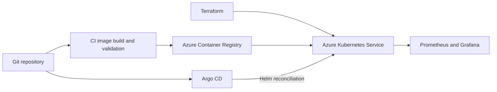

# Event-Driven Order Processing Platform for AKS

An event-driven microservices portfolio project focused on **Azure Kubernetes Service (AKS)**, with a delivery design based on **Azure Container Registry, Terraform, Helm, Argo CD, Prometheus and Grafana**.

The application combines four Python/FastAPI services, an Nginx dashboard, RabbitMQ messaging and PostgreSQL persistence. AKS is the intended cloud platform; local development is an optional supporting workflow.

## AKS architecture



This diagram describes the Azure delivery design. See the [architecture](docs/ARCHITECTURE.md) for the application layout and the [delivery plan](docs/IMPLEMENTATION_PLAN.md) for remaining work.

## Application workflow

1. The dashboard submits an order through Nginx to the Order API.
2. Order stores the request and publishes `order.created`.
3. Inventory reserves stock or publishes `inventory.failed`.
4. Payment records a simulated payment and publishes `payment.completed`.
5. Notification records workflow events for the dashboard.

The services use separate tables within one PostgreSQL database. Payments are simulated; notifications are stored records rather than delivered email or SMS.

## Technology and repository status

| Area | Technology | Repository status |
| --- | --- | --- |
| Application | Python, FastAPI, JavaScript, Nginx | Implemented |
| Messaging and data | RabbitMQ, PostgreSQL | Implemented |
| Packaging | Docker, Kubernetes manifests, Helm | Included; cloud configuration needs adaptation |
| Cloud platform | AKS, Azure Container Registry | Target deployment environment |
| Infrastructure | Terraform | Directory reserved; implementation pending |
| Continuous delivery | CI pipelines, Argo CD | Directories reserved; implementation pending |
| Monitoring | Prometheus, Grafana | Planned |

Existing runtime evidence covers the local Kubernetes baseline. **An AKS deployment has not been verified in this repository.** Historical results remain in [validation](docs/VALIDATION.md).

## Explore the project

- [AKS architecture](docs/ARCHITECTURE.md)
- [Architecture and event-flow diagrams](docs/ARCHITECTURE_DIAGRAMS.md)
- [Project guide](docs/PROJECT_GUIDE.md)
- [AKS delivery roadmap](docs/ROADMAP.md)
- [Detailed delivery plan](docs/IMPLEMENTATION_PLAN.md)
- [Application limitations](docs/REVIEW.md)
- [Demo and evidence checklist](docs/DEMO.md)

## Repository layout

```text
services/              Four FastAPI services and their Dockerfiles
frontend/              Dashboard and Nginx API routing
k8s/                   Existing Kubernetes manifests from the local baseline
helm/order-platform/   Existing application Helm chart
infra/terraform/       Reserved Azure infrastructure directory
infra/vault/           Optional existing local Vault configuration
deploy/argocd/         Reserved GitOps configuration directory
pipelines/             Reserved CI configuration directory
tests/                 Application smoke and consumer-recovery checks
docs/                  AKS design, delivery plan and historical evidence
```

## Optional local development

Docker Compose and the [local Kubernetes guide](docs/MINIKUBE.md) remain available for development and historical reproduction. Local execution is not evidence of a completed AKS deployment.

The existing Compose configuration and legacy Helm chart contain disposable development credentials. Adapt credentials, image references, persistence and access controls before using them on Azure. Do not install the chart over existing resources without reviewing ownership and data preservation.

## Current application limits

Order status remains `created`; duplicate-event protection and transactional event publication still need work. Moving the application to AKS does not, by itself, resolve these application-level limitations.
