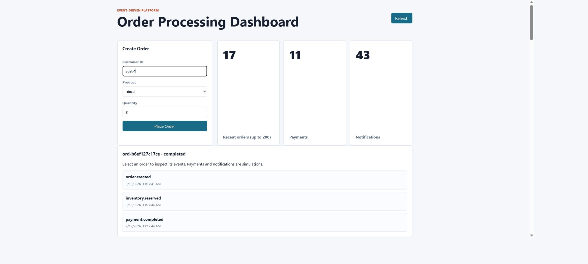
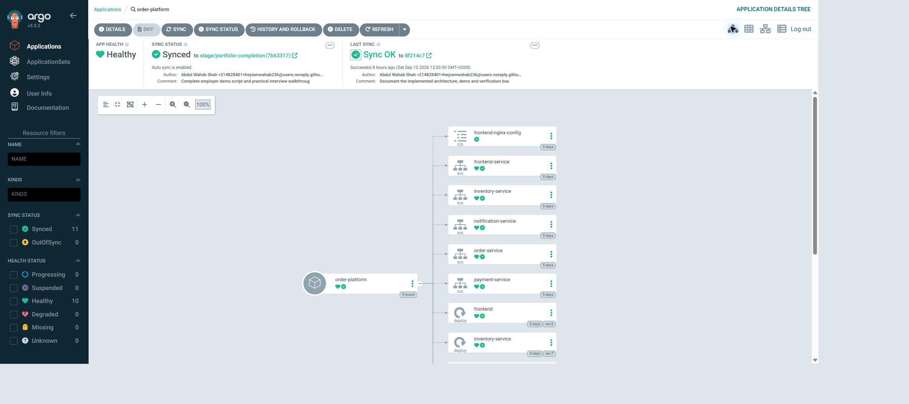
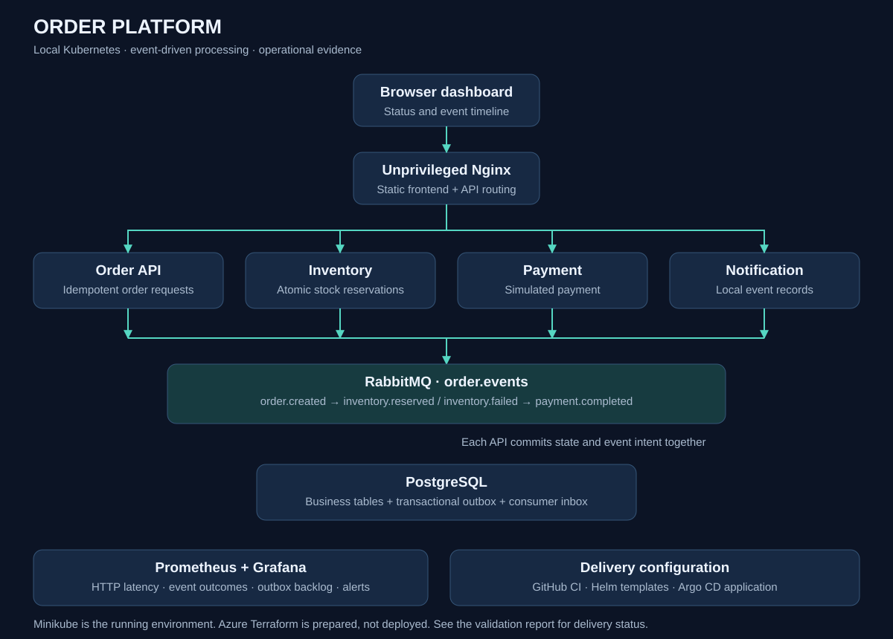

# Event-driven Order Platform | Kubernetes DevOps Portfolio

A hands-on DevOps portfolio: four Python/FastAPI services process orders through RabbitMQ, with PostgreSQL transactions, a browser dashboard, Kubernetes deployment, delivery automation and operational evidence.

**Current environment: local Minikube.** The repository name describes the Azure direction; Terraform for AKS/ACR is prepared and validated, not deployed. Payments are simulations and notifications are database records. The frontend is HTML/CSS/JavaScript served by unprivileged Nginx.

## Project at a glance

**Purpose:** demonstrate deployment, reliability, observability and troubleshooting for an asynchronous order-processing application.

**Stack:** Python/FastAPI · Docker · Kubernetes/Minikube · Helm · Argo CD · RabbitMQ · PostgreSQL · Prometheus · Grafana · JMeter · Bandit · pip-audit · Trivy · ZAP. Optional Azure infrastructure is defined in Terraform.

| Engineering work | Evidence |
| --- | --- |
| Reliable events and stock handling | Outbox/inbox transactions, duplicate-delivery, concurrent-stock and broker-recovery checks |
| GitOps deployment | Argo CD Synced/Healthy; deliberate replica drift automatically corrected |
| Operational troubleshooting | Database DNS failure diagnosed from logs; final 25-user test completed 7,500 read requests without errors |
| Security verification | Source/dependency/image checks, SBOM and passive web scan; unresolved findings documented |

**Start here:** [Screenshots and project overview](docs/EMPLOYER_OVERVIEW.md) · [Measured results](docs/PORTFOLIO_REPORT.md) · [Resume entry](docs/RESUME_PROJECT.md)


*Actual local application: an order progresses from creation through stock reservation to simulated payment completion.*


*Actual GitOps application, captured Healthy and Synced.*



## What to review first

- [Architecture and design tradeoffs](docs/ARCHITECTURE.md)
- [Demonstration guide](docs/DEMO.md)
- [Spoken interview walkthrough and answers](docs/INTERVIEW_WALKTHROUGH.md)
- [Validation evidence and remaining limitations](docs/PORTFOLIO_REPORT.md)
- [Performance investigation](docs/PERFORMANCE.md)
- [Security findings and remediation](docs/SECURITY.md)
- [Local setup](docs/MINIKUBE.md) and [operations](docs/OPERATIONS.md)

## Engineering features

- Order progress and per-order event timeline, including insufficient-stock failures.
- Atomic business changes and outbox writes; confirmed publishing with duplicate-safe consumers.
- PostgreSQL row locks for stock reservations, request idempotency and bounded retries/dead-letter handling.
- Docker images running without root, read-only application filesystems, health probes, resource limits and no mounted service-account token.
- An application-only Helm chart; Argo CD configuration excludes database storage and secrets.
- GitHub Actions workflow for tests, SAST, dependency audit, container scanning, SBOMs, passive DAST and Helm validation.
- Prometheus metrics/alerts, a provisioned Grafana dashboard, and a repeatable JMeter workload.

## Quick local development

```sh
docker compose -p order-dev up -d --build --wait
python tests/local_scenarios.py http://127.0.0.1:8080
```

Compose credentials are disposable examples. The existing Minikube lab uses separate, uncommitted credentials. Tests leave labelled order records; the acceptance suite consumes one unit of stock. See the reports for checks actually executed and for issues still open.

## Repository map

| Path | Purpose |
| --- | --- |
| services/, shared/ | Business APIs, outbox/inbox and instrumentation |
| frontend/ | Browser dashboard and Nginx configuration |
| k8s/ | Local bootstrap manifests |
| helm/order-platform/ | Stateless application release chart |
| deploy/argocd/ | Restricted project and GitOps application |
| deploy/observability/ | Prometheus, alert rules and Grafana |
| tests/ | Transaction, integration, failure and load checks |
| infra/terraform/ | Optional Azure infrastructure |
| docs/ | Demo, evidence, operations and tradeoffs |
