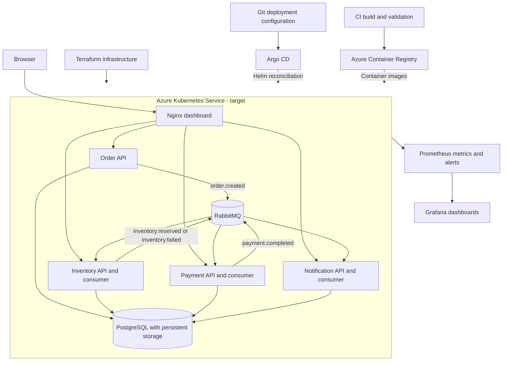

# AKS architecture

AKS is the target runtime for this project. The diagram below describes the intended Azure deployment, not a recorded live environment. The existing application retains RabbitMQ and PostgreSQL; using AKS does not require rewriting it for Azure Service Bus.

## Delivery responsibilities

- **Terraform:** provision the Azure resource group, networking, AKS, ACR and required identity assignments.
- **CI:** validate changes, build versioned images and publish them to ACR.
- **Helm:** describe the application workloads, configuration, service endpoints and persistent storage.
- **Argo CD:** reconcile reviewed deployment configuration from Git into AKS.
- **Prometheus and Grafana:** collect operational metrics, display dashboards and support alert investigation.

These are design responsibilities. Terraform, CI, Argo CD and monitoring configuration remain pending in the checked-in implementation.

## Application boundaries

The four services share a PostgreSQL database with separate tables. RabbitMQ carries asynchronous business events; HTTP serves the dashboard and API queries. Payments are simulated and notifications are database records.

Managed PostgreSQL, Azure Service Bus, Key Vault and public ingress/TLS are optional future design decisions. They are not prerequisites already implemented in this repository.

## Verification

Record Azure resource identifiers, source revision, rollout results, a successful order workflow, storage checks, GitOps reconciliation and a triggered monitoring alert before marking the AKS architecture as deployed. See [demo evidence](DEMO.md). Earlier local test results remain in [validation](VALIDATION.md).
