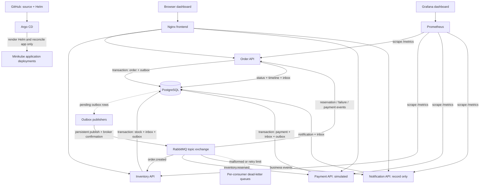

# Architecture

The event sequence is `order.created → inventory.reserved → payment.completed`. Insufficient stock produces `inventory.failed` and no payment. Notification records each subscribed event; the order consumer updates status and timeline. Timeline times are observation times, not a guaranteed global causal ordering.

## Why these choices

**Transactional outbox:** database changes and event intent commit together. A publisher marks the event sent only after broker confirmation. A crash between confirmation and the sent flag can duplicate delivery, so the system promises at-least-once delivery with idempotent business effects, not exactly-once transport.

**Inbox:** `(consumer, order ID + event type)` uniquely identifies a processed business transition. A PostgreSQL advisory lock serializes duplicate transitions; the inbox row commits in the same transaction as the business effect. This simple key assumes one transition of each type per order. Multi-payment attempts or compensation would need a richer event identity.

**Stock:** products are locked in sorted order before checking and updating quantities, preventing overselling and reducing lock-order deadlocks. The API rejects empty lists, duplicate products, zero/negative quantities and oversized input.

**Shared PostgreSQL:** this lab prioritizes explainable transactions and low resource use. Each service owns its business tables; the shared database and credentials are a deliberate limitation. Production service isolation, least-privilege database roles and backup/restore automation remain future work.

**Kubernetes:** explicit service DNS names avoid short-name fallbacks to the external resolver. The Helm chart owns application Deployments, Services and frontend configuration only. PostgreSQL/RabbitMQ StatefulSets and PVCs remain separately managed.

## Boundaries

Single-node Minikube, one broker and one database are not highly available. Payment has no real financial integration or compensation logic. The API has no authentication/TLS and is exposed only through local port forwards. No production traffic, real customer data or credentials belong in this demo.

References: [RabbitMQ reliability](https://www.rabbitmq.com/docs/reliability), [publisher confirms and acknowledgements](https://www.rabbitmq.com/docs/3.13/confirms).
