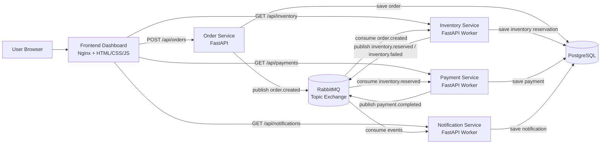
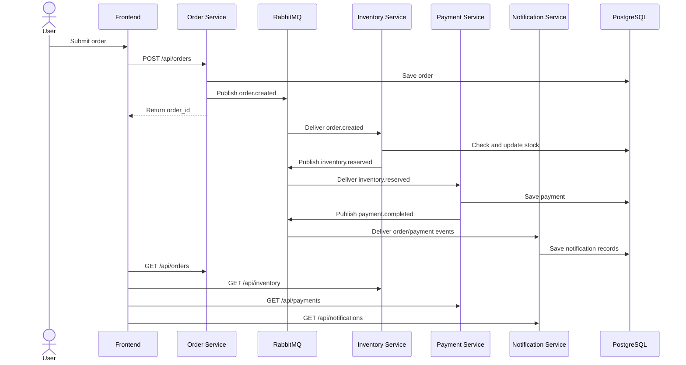
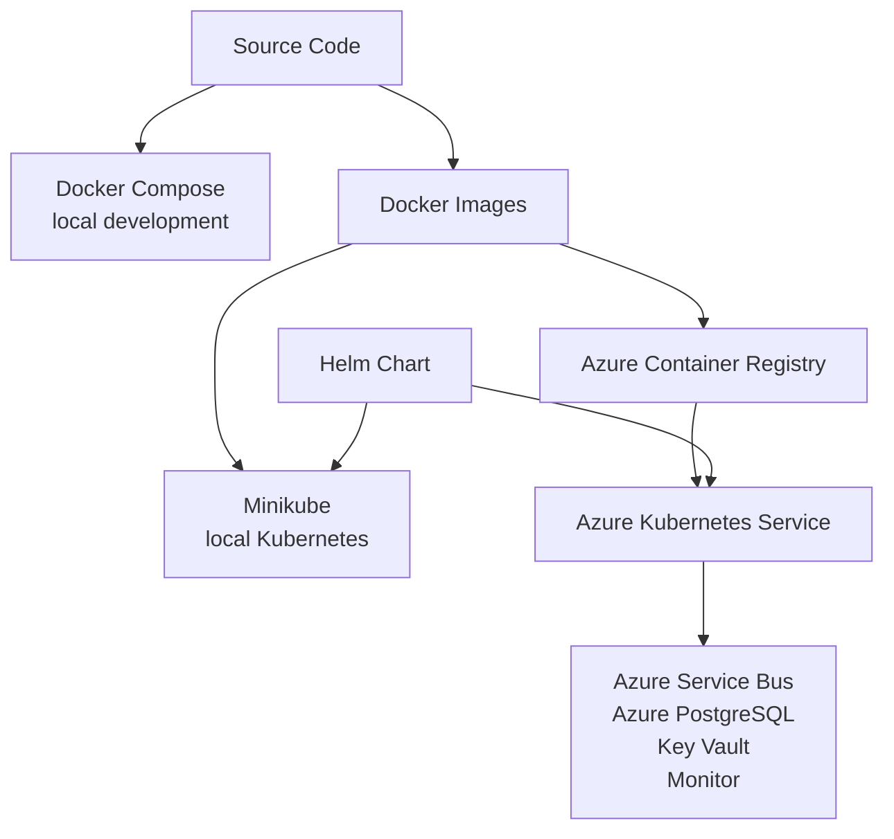
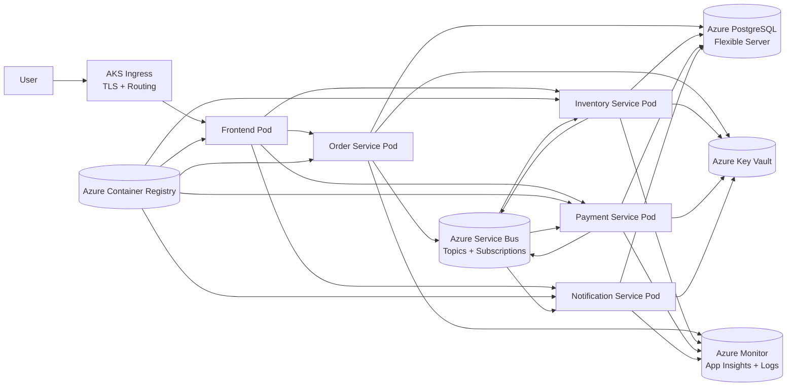

> Historical baseline document. See README.md and PORTFOLIO_REPORT.md for the current implementation.

# Architecture Diagrams

## Local System Architecture

## Order Processing Sequence

## Deployment Progression

## Production Target Architecture

