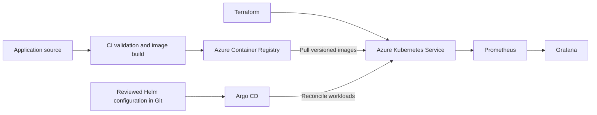
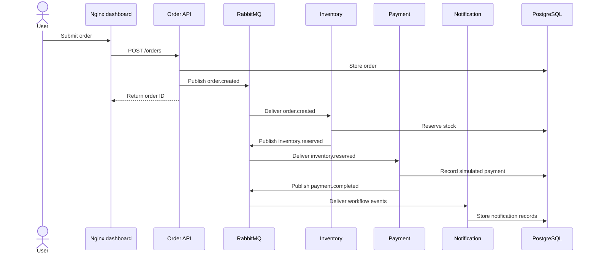

# AKS and application diagrams

The infrastructure and delivery diagrams are the target design. The event sequence describes the existing application behavior.

## Azure delivery design

## Application workflow

Insufficient stock produces `inventory.failed` and does not proceed to payment. This diagram does not imply transactional event publishing, duplicate-event protection or external payment delivery.

## Runtime layout

See the complete [AKS architecture](ARCHITECTURE.md). Local development remains an optional way to exercise the same application; it is not the primary platform in the Azure design.
