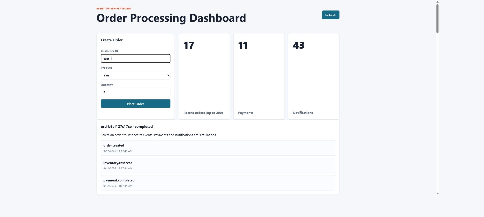
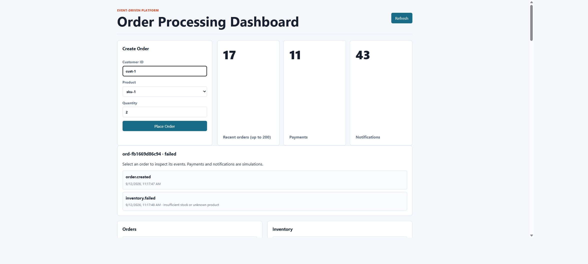
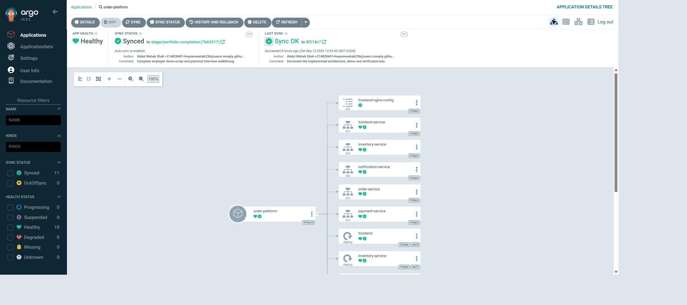
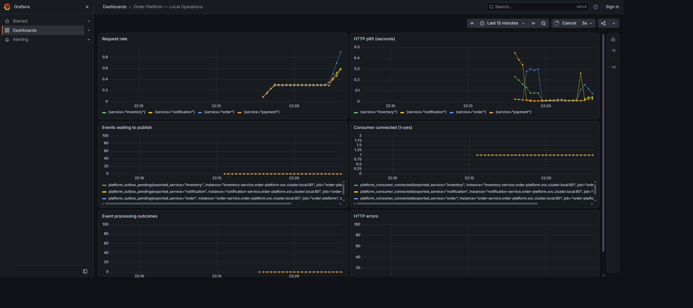

# Event-driven Order Platform

DevOps portfolio by Abdul Wahab Shah

## The problem and the implementation

An order crosses several service boundaries. A broker outage, duplicate message or competing stock request must not silently lose an order or repeat its business effects. This project combines a Python order-processing application with a local Kubernetes operating environment to demonstrate how these failures are handled and observed.

Order, inventory, payment and notification services communicate through RabbitMQ and persist data in PostgreSQL. Nginx serves the browser frontend. Helm describes the application release; Argo CD reconciles it from Git. Prometheus and Grafana expose runtime behavior.

## Application evidence

The selected order has order.created, inventory.reserved and payment.completed events. Payment is simulated and notifications are local database records.

A separate test order records inventory.failed with an insufficient-stock reason. These are existing synthetic test records, not customer transactions.

## Deployment evidence

Argo CD reports Healthy and Synced for the application Helm chart. A separate verified drift test increased notification replicas from one to two; Argo restored the Git-defined value of one. This screenshot shows status, not a recording of that test.

## Observability evidence

Live local metrics show request traffic, latency, pending outbox events and consumer connectivity. This capture shows ordinary dashboard activity, not the earlier JMeter load run. Monitoring history is ephemeral.

## Measured engineering results

- Ten transaction tests passed; live PostgreSQL/RabbitMQ tests exercised duplicate deliveries, competing stock and malformed messages.
- A broker-outage drill accepted an order into the outbox and completed it after broker recovery.
- An initial load run had 278 errors among 7,500 read requests. Logs identified database DNS failures; explicit service DNS names removed errors in the equivalent final run.
- The final run used 25 concurrent users: orders p95 783 ms, inventory 614 ms, notifications 1,492 ms. Notification latency remains above the one-second target.
- Dependency and header findings were remediated. The final passive ZAP scan had two informational alerts; backend vendor-unfixed OS findings remain tracked.

[Performance details](PERFORMANCE.md) · [Security details](SECURITY.md) · [Architecture](ARCHITECTURE.md) · [Demo guide](DEMO.md)

## Scope and reproducibility

Running environment: single-node Minikube. AKS/ACR Terraform is prepared and validated but not deployed. Application images were built locally; automatic registry image promotion is unfinished. The GitHub-hosted workflow did not execute because of an account restriction. Local testing and Argo CD do not require paid hosted execution.

This is a learning/portfolio environment, not production infrastructure. Public authentication/TLS, database isolation, production backups, real payment integration and external alert routing require further work. See [local operations](OPERATIONS.md) to reproduce the demonstration.

Screenshots captured on 12 September 2026 from the running local environment. No application data or status was altered for the images. The repository currently requires GitHub access; localhost links work only on the host computer.
